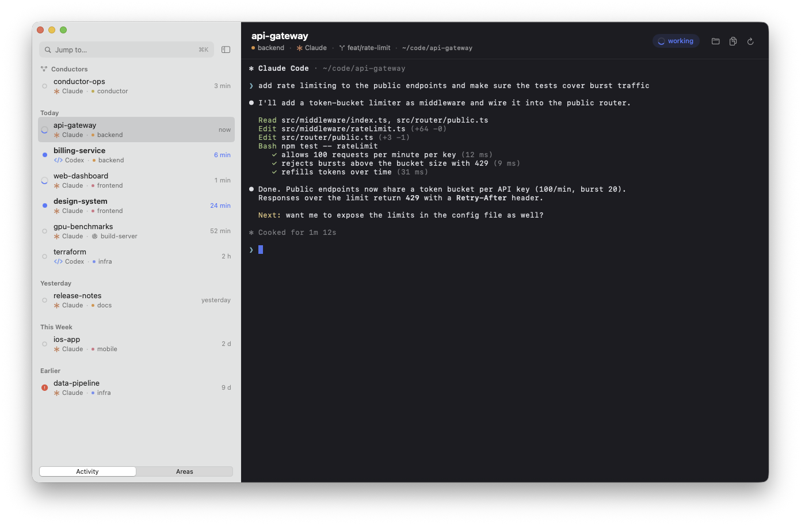
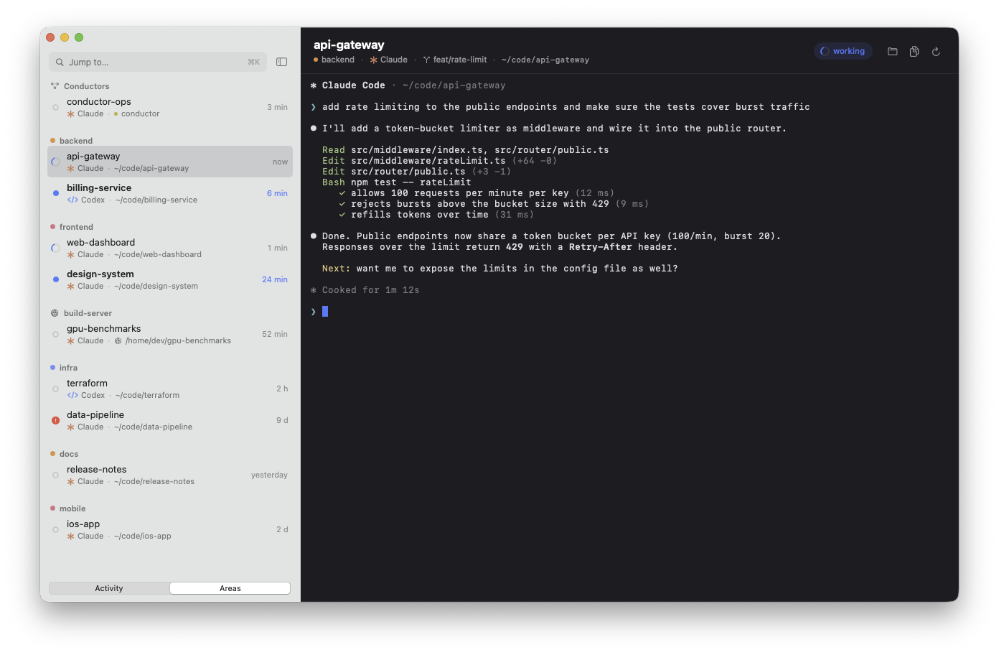
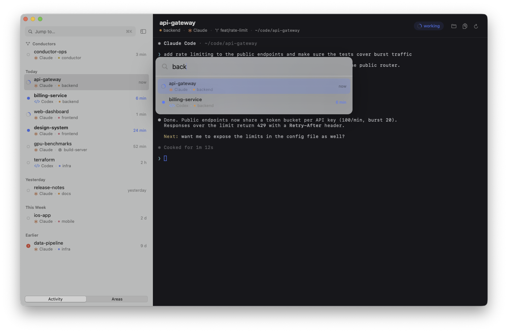

# DeckTabs

A small native macOS app for [agent-deck](https://github.com/asheshgoplani/agent-deck): every agent-deck
session (Claude Code, Codex, …) becomes a tab in a Things-style sidebar, and the pane on the right is the
real terminal of that session. Sessions keep running in tmux; the app only attaches to them.



Built because switching between many long-running agent sessions in one terminal got tedious: I wanted them
always at hand, sorted by last activity, with a clear signal for “something new happened here”.

| Grouped by area, drag & drop between groups | ⌘K jump to any session |
|---|---|
|  |  |

## Requirements

- macOS 15 or later, Xcode command line tools (Swift 6)
- [agent-deck](https://github.com/asheshgoplani/agent-deck) and tmux on the `PATH`
  (looked up in `~/.local/bin`, `/opt/homebrew/bin`, `/usr/local/bin`)

## How it works

DeckTabs only uses agent-deck's CLI, no private files:

| What | Command |
|---|---|
| Session list (every 2.5 s) | `agent-deck list --json` |
| Remote sessions (every 10 s) | `agent-deck remote list --json`, `agent-deck remote sessions <name> --json` |
| Groups / drag & drop | `agent-deck group list --json`, `agent-deck group move <id> <group>` |
| Terminal | `tmux attach-session -t <tmux_session>` locally, `agent-deck remote attach <remote> <id>` remotely |

The terminal is [SwiftTerm](https://github.com/migueldeicaza/SwiftTerm); one client per opened session
is kept alive, so switching is instant and scrollback survives.

## Features

- Things-style sidebar: time buckets (Today / Yesterday / This Week / Earlier) or by area
  (switch at the bottom, ⌃⌘1 / ⌃⌘2); conductors pinned on top; calm per-area colors
- Meaningful status: spinning arc = working, blue dot = new since you last looked (like unread in Mail),
  hollow circle = ready, red ! = error
- Dock badge and menu bar extra count only new sessions; the menu bar lists New / Working / Recently Active
- Remote sessions (agent-deck remotes, e.g. `build-server`) show a network glyph; polled every 10 s over SSH
- In “Areas”, drag local sessions into another group (`agent-deck group move`); empty groups stay visible as targets
- Each row shows the harness (Claude, Codex, Gemini, …) with its own glyph; the header adds the git branch
- Header: title, area, tool, branch, path, status pill, reveal folder, copy attach command, reconnect
- Terminal with a muted palette and padding; if the connection drops you get a “No Connection” state
  instead of a reconnect loop
- Keys: ⌘K jump to (floating search, also matches folders), ⌘J next new session, ⌘1–⌘9 direct
  (hold ⌘ to see the numbers), ⌘[ / ⌘] cycle, ⌃⌘S toggle sidebar, ⇧⌘R reconnect,
  ⌃⌥Space brings the app to the front from anywhere

## Language

English is the development language. German translations live in `Resources/de.lproj/Localizable.strings`;
the app follows the macOS language. Force English with
`open -n build/DeckTabs.app --args -AppleLanguages '(en)'`.

## Build & install

```bash
./bundle.sh                       # → build/DeckTabs.app (ad-hoc signed, icon from icon/)
osascript -e 'quit app "DeckTabs"'
rm -rf /Applications/DeckTabs.app && ditto build/DeckTabs.app /Applications/DeckTabs.app
open /Applications/DeckTabs.app
```

To start it at login, add it under System Settings → General → Login Items.

### Demo mode

`open -n build/DeckTabs.app --args --demo` (or `DECKTABS_DEMO=1`) shows made-up sessions and a fake
transcript – handy for screenshots without leaking real session content.

## Known limitations

- The session list is polled (`agent-deck list --json` every 2.5 s). Real-time updates would come from
  `agent-deck events follow --json --kind session.status,session.turn` (needs `[macapp] status_events = true`).
- tmux uses `window-size latest`: using the same session in a terminal and in the app at the same time makes
  the window size jump to the most recent client.
- agent-deck's status line and Ctrl+Q binding are tmux-global and also show up here.
- Conductors are detected by group/title prefix `conductor` (`list --json` has no `is_conductor`).
- agent-deck's author is building an official Mac app (chat view rendered from transcripts, browser panel,
  remotes) on top of the interface in agent-deck's `docs/macapp-core.md`. DeckTabs is a different take –
  the raw terminal in tabs – and would happily switch to those events/APIs.

## License

MIT
